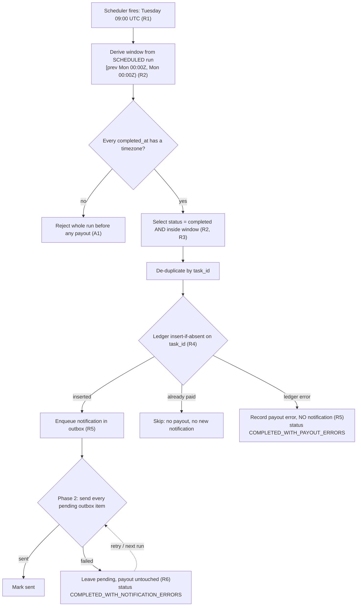
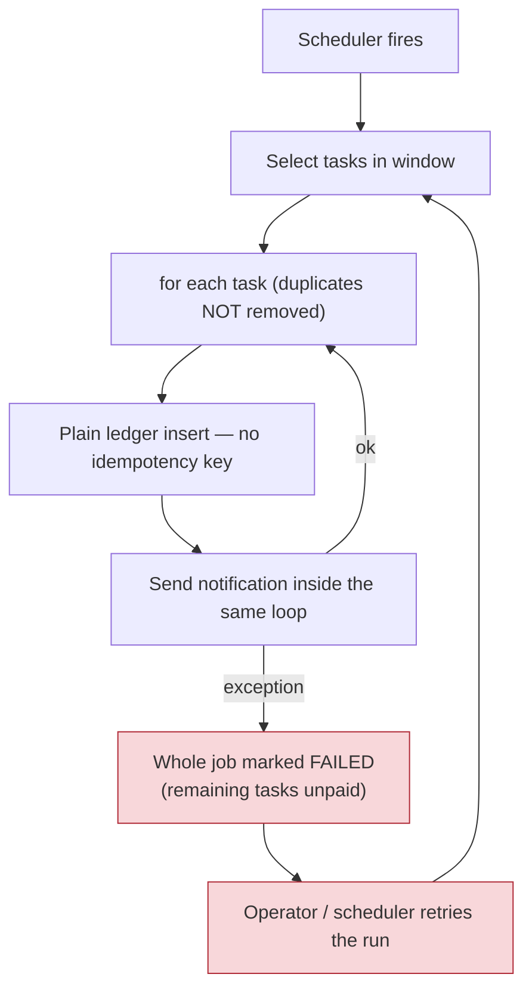

# Flow map — weekly rewards settlement (fictional)

> SYNTHETIC assessment scenario. Not a description of any live product.

## Corrected flow (fixed build)

## Faulty flow (DEF-001) — where it breaks

**Failure point:** the payout (money moved) and the notification (best-effort message) share one unit of
work. A notification failure turns a run that *has already paid* into a FAILED run, and the retry
mechanism — which is correct to exist — re-executes payouts because nothing marks a `task_id` as paid.

## Actors and data
| Element | Role | In this fixture |
|---|---|---|
| Scheduler | Triggers the run; retries FAILED runs | Test calls `settle()` again with the same `scheduled_run` |
| Task feed | Supplies completed tasks | `fixtures/week_2026-10-05.json` / inline test data |
| Ledger | Source of truth for payouts | `InMemoryLedger` (`insert` = no unique key, `insert_if_absent` = unique on `task_id`) |
| Outbox | Durable list of notifications owed | `NotificationOutbox` (fixed build only) |
| Notifier | Sends user notifications | `FakeNotifier` with injectable failures |

## Assumptions (untested against any real system)
- **A1** Timestamps without a timezone are invalid; the run is rejected before any payout rather than guessing a zone.
- **A2 Account changes** *(not implemented)*. Account status is read at the scheduled run time. *Suspended:* the payout is held with no notification, then paid once in a later run after reinstatement. *Closed:* not paid, and reported as skipped. The fixture treats every account as active.
- **A3** A retry re-submits the same task feed for the same `scheduled_run`.
- **A4** "Previous Monday … following Monday" is read as the last *complete* Monday-to-Monday week before the Tuesday run: run 2026-10-13 settles `[2026-10-05T00:00Z, 2026-10-12T00:00Z)`. Tasks completed Monday 00:00 – Tuesday 09:00 belong to the next run.
- **A5** Credits are test units; no currency conversion or rounding is involved.
- **A6 Admin settings** *(not implemented)*. *Credit-rate change:* the rate in effect at the scheduled run time applies to the whole window. *Pause:* the paused week is settled by a later manual run of its original scheduled time; R2 and R4 keep it exact and single. *Manual re-run of a past week:* same mechanism as a retry (TC11).
- **A7** If the same `task_id` appears more than once in a feed with different users, the first occurrence wins (TC18).
